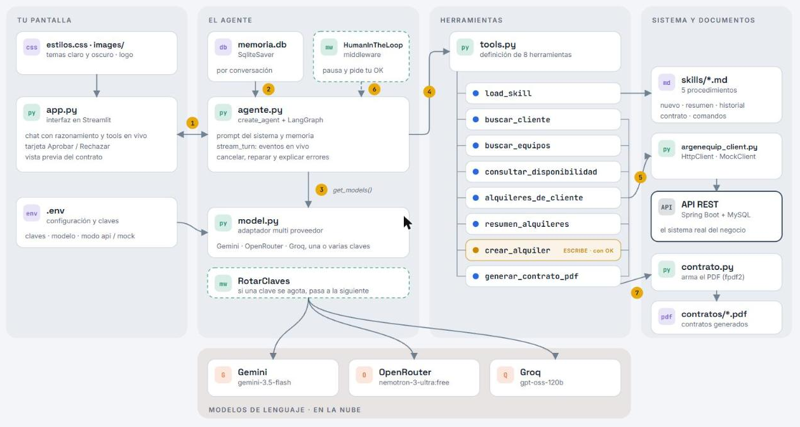

# ArgenEquip · Asistente de alquileres con IA

Agente conversacional (LangChain `create_agent` + LangGraph) que ayuda a un socio de **ArgenEquip**, un sistema de gestión de alquiler de herramientas y equipos para obra, a operar el sistema escribiendo en lenguaje natural. Proyecto integrador de *Modelos de Lenguaje* (Unidad 5: agentes).

Comandos disponibles hoy:

| Comando | Qué hace |
|---|---|
| `nuevo` | Crea un alquiler paso a paso: busca el cliente (y pregunta cuál si hay homónimos), elige el domicilio, busca los equipos, verifica disponibilidad en las fechas, **pide confirmación humana** y lo registra. El stock se reserva al crear. Al confirmarse, **genera el contrato en PDF** y lo muestra en el chat. |
| `resumen` | Muestra todos los alquileres activos con sus equipos, valor y estado de pago. |
| `historial` | Lista **todos los alquileres de un cliente**, en cualquier estado, con equipos, valor, pagado, saldo y totales (ej.: *«listame todos los alquileres de Juan Pérez»*). Si hay homónimos, pregunta cuál. |
| `contrato` | Genera el **PDF del contrato** de un alquiler existente (ej.: *«generame el contrato del alquiler 12»*). Los datos salen del sistema y las cláusulas son fijas. Si no queda claro de qué alquiler, pregunta. En la pantalla se ve el contrato (vista previa) y el botón *Descargar contrato (PDF)*. También se genera solo al crear un alquiler con `nuevo`. |
| `cancelar` | Cancela la operación en curso (en la UI: botón *Rechazar* de la confirmación). |

Se pueden escribir como comando suelto (`resumen`) o en una frase libre (*«Quiero alquilarle a Pérez una hormigonera del 24 al 28 por 120000»*). Las fechas se piden y se muestran siempre en formato **DD-MM-AAAA** (por ejemplo `24-11-2026`); hacia el backend viajan en ISO.

## Arquitectura

```
[Streamlit UI] ─► [Agente Python (create_agent)] ──HTTPS──► Gemini (nube)
                          │  devuelve tool_calls ◄──────────────┘
                          ▼  las tools se ejecutan LOCALMENTE
                  argenequip_client.py
                    ├─ modo mock: datos en memoria (sin backend)
                    └─ modo api : API REST Spring Boot (localhost) ─► MySQL
```

El modelo en la nube **nunca toca el sistema**: solo decide qué tool llamar y con qué argumentos. Las tools corren en tu máquina y usan la API REST (no la base directamente), de modo que se respetan las validaciones del backend.

### Diagrama del flujo del agente



Los números muestran el recorrido de un pedido: **1** el socio escribe en la interfaz, **2** el agente arma el contexto con la memoria de la conversación, **3** el modelo del proveedor elegido (Gemini, OpenRouter o Groq) decide qué hacer, **4** se ejecuta la herramienta en tu máquina, **5** la herramienta habla con el sistema real a través del cliente de la API, **6** si va a escribir, el middleware pausa y pide la aprobación del socio, **7** se genera el contrato en PDF. Después la respuesta vuelve a la pantalla.

Hay una versión **interactiva** (se recorre el pedido paso a paso y cada pieza explica qué hace): [`docs/diagrama-agente-argenequip.html`](docs/diagrama-agente-argenequip.html). GitHub no la muestra como página, solo como código: descargá el archivo y abrilo en el navegador.

## Requisitos

- **Python 3.11 o superior** (probado en 3.14).
- Una **API key de Gemini** (gratis, desde Google AI Studio).
- Solo para el modo `api`: el backend ArgenEquip (Spring Boot + MySQL) corriendo en local y un usuario con rol SOCIO. Para el modo `mock` no hace falta nada más.

## Instalación

```bash
git clone https://github.com/ezeabadie/argenequip-agente.git
cd argenequip-agente

# Entorno virtual
python -m venv .venv                  # en Windows también sirve: py -m venv .venv
.venv\Scripts\activate                # Windows (PowerShell/cmd)
source .venv/bin/activate             # macOS / Linux

# Dependencias
pip install -r requirements.txt
```

## Configuración

1. Copiá la plantilla de variables de entorno:

   ```bash
   copy .env.example .env             # Windows
   cp .env.example .env               # macOS / Linux
   ```

2. Conseguí tu API key en <https://aistudio.google.com/apikey> (*Create API key*) y pegala en `.env`.

3. Elegí el modo de ejecución. Variables del `.env`:

| Variable | Descripción |
|---|---|
| `GOOGLE_API_KEY` | Clave de Gemini (obligatoria si usás Gemini). Admite **varias separadas por coma** (`clave1,clave2`): si una se queda sin cupo, el agente pasa solo a la siguiente (la barra lateral muestra *Clave N de M*, nunca la clave). Usá solo claves propias o con permiso de su dueño, y respetá los términos del proveedor. |
| `OPENROUTER_API_KEY` | Clave de OpenRouter (<https://openrouter.ai/keys>); solo si elegís ese proveedor. También admite varias separadas por coma. |
| `GROQ_API_KEY` | Clave de Groq (<https://console.groq.com/keys>); solo si elegís ese proveedor. También admite varias separadas por coma. |
| `MODEL_PROVIDER` | Proveedor con el que arranca la app: `google_genai` (por defecto), `openrouter` o `groq`. Se cambia después desde la barra lateral. |
| `MODEL_NAME` | Modelo de Gemini. Por defecto `gemini-3.5-flash`, que devuelve el razonamiento que muestra la UI. |
| `OPENROUTER_MODEL` | Slug del modelo de OpenRouter (los gratuitos terminan en `:free`). Tiene que soportar *tool calling*. |
| `GROQ_MODEL` | Id del modelo de Groq. Por defecto `openai/gpt-oss-120b` (probado con tools y devuelve razonamiento). También andan `openai/gpt-oss-20b` y `qwen/qwen3.8-27b`. Tiene que soportar *tool calling*. |
| `ARGENEQUIP_MODE` | `mock` (datos de prueba en memoria) o `api` (backend real). |
| `ARGENEQUIP_BASE_URL` | Solo modo `api`. Ej.: `http://localhost:8080`. |
| `ARGENEQUIP_USER` / `ARGENEQUIP_PASSWORD` | Solo modo `api`. Credenciales de un usuario SOCIO. |

> **El archivo `.env` está en `.gitignore`: nunca lo subas ni pegues tu clave en otros archivos.** `.env.example` solo lleva valores de ejemplo.

### Modo `mock` (recomendado para probar)

Con `ARGENEQUIP_MODE=mock` el proyecto corre solo con Python. Trae datos de prueba:

- Clientes: **Juan Pérez** (domicilios *San Martín 450* y *Las Heras 88*), **Carlos Pérez** (*Belgrano 1200*) y **María Gómez**.
- Equipos: Hormigonera (3), Andamio (10), Amoladora (5), Taladro (4).
- Un alquiler previo (*Obra Mitre*) que ocupa 2 hormigoneras, útil para ver el error de stock insuficiente.

Los datos viven en memoria: se reinician cada vez que se reinicia la aplicación.

### Modo `api` (backend real)

Con `ARGENEQUIP_MODE=api`, el cliente hace login (`POST /api/auth/login`) y usa el token JWT; si vence, vuelve a iniciar sesión automáticamente. Levantá primero el backend y completá `ARGENEQUIP_BASE_URL`, `ARGENEQUIP_USER` y `ARGENEQUIP_PASSWORD`.

## Cómo ejecutarlo

### Interfaz web (Streamlit)

```bash
streamlit run app.py
```

Se abre en <http://localhost:8501>. En la pantalla vas a ver, en vivo mientras el agente trabaja:

- 💭 el **razonamiento** del modelo (desplegable),
- cada **tool invocada** con sus argumentos y su resultado, en orden,
- la respuesta en markdown,
- mientras trabaja, **qué paso va**: *«Pensando…»*, *«Paso 2 hecho: Buscando el equipo «taladro» · pensando el siguiente…»*. Las tools tardan milisegundos; lo largo es la espera al modelo, y así no parece un cuelgue,
- cuando una operación modifica el sistema, una tarjeta de **confirmación** con los botones **Aprobar** / **Rechazar**. La tarjeta muestra **el nombre del cliente (con su DNI), su domicilio de entrega y los equipos por nombre**, no ids sueltos, y avisa con ⚠️ si el domicilio no es uno de los del cliente,
- al tocar **Aprobar** o **Rechazar**, la tarjeta pasa a mostrar «se está ejecutando…» **sin botones** (la vieja seguiría en pantalla, clickeable, durante toda la espera del modelo, y un segundo clic interrumpe el turno a medias). Si una conversación igual quedó cortada justo después de que el modelo pidió una tool, se **repara sola** al enviar el siguiente mensaje (se completa la llamada con un aviso de error), porque una llamada sin resultado haría que el proveedor rechace todo lo que sigue,
- un botón **⏹ Detener** mientras el agente trabaja: cancela la respuesta, borra ese turno del historial y te devuelve tu mensaje en la caja para **editarlo y reenviarlo**. Mientras el agente trabaja la caja de chat queda bloqueada.

La interfaz usa un tema oscuro (`.streamlit/config.toml` + `estilos.css`) y muestra una pantalla de bienvenida con atajos cuando la conversación está vacía. La barra lateral lleva el **logo de ArgenEquip** en la esquina superior y se **oculta y se vuelve a abrir** con la flecha de su esquina (« / »; con la barra cerrada queda el icono de la marca arriba a la izquierda). Tiene primero el **selector de proveedor** (Gemini, OpenRouter o Groq) y después la lista de conversaciones, **agrupadas por día** (*Hoy*, *Ayer*, o la fecha en DD-MM-AAAA) y con un botón 🗑 para **borrar** cada una (pide confirmación: no se puede deshacer). Cada conversación conserva su memoria, también si cambiás de proveedor a mitad de camino. El **modelo de cada proveedor no se edita desde la pantalla**: sale del `.env` (`MODEL_NAME`, `OPENROUTER_MODEL`, `GROQ_MODEL`) y la cabecera muestra cuál está en uso y si el sistema es real o de demo. Si falta la clave del proveedor elegido, la UI avisa y sigue con el anterior. Las cajas de razonamiento y de herramientas nacen plegadas y **no cambian entre abiertas y cerradas** mientras el agente trabaja ni al redibujarse. **Cada vez que se levanta Streamlit se arranca en una conversación nueva**; las anteriores quedan en la lista (si recargás la página con el servidor ya andando, seguís en la última que usaste).

### Consola

```bash
python agente.py
```

Mismo agente, sin interfaz gráfica: imprime razonamiento, tools y resultados, y pregunta `¿Aprobás? (s/n)` ante una escritura.

### Tests

```bash
pytest
```

Los tests **no usan la API de Gemini** (el modelo se reemplaza por uno falso) ni el backend.

## Guion de demo (funciona en modo `mock`)

1. `nuevo: quiero alquilarle a Pérez una hormigonera del 24 al 28 de este mes por 120000`
   → hay dos Pérez: el agente pregunta cuál.
2. `Juan Pérez, el de San Martín` *(usa la memoria de la conversación)*
   → verifica la disponibilidad y **se pausa pidiendo confirmación** con el resumen del alquiler.
3. Tocá **Aprobar** → se crea el alquiler y el stock queda reservado.
4. `resumen` → lista los alquileres activos, incluido el nuevo, con equipos, valor y estado de pago.
5. `listame todos los alquileres de Juan Pérez` → carga la skill `historial`, busca al cliente y muestra todos sus alquileres con los totales.
6. `generame el contrato del alquiler 2` → carga la skill `contrato`, genera el PDF y aparece el botón **Descargar contrato (PDF)**.

> El plan gratuito de Gemini tiene límites bajos y la latencia puede ser de varios segundos por respuesta. Una demo completa usa unas 8 llamadas al modelo.

## Estructura del repositorio

```
├── app.py                 # UI Streamlit: eventos en vivo + botones de aprobación
├── estilos.css            # estilos de la UI (burbujas, tarjetas, botones, caja de chat)
├── images/                # logo de ArgenEquip: el original (logoArgenEquip.jpg) y dos recortes para la UI (logo.png, icono.png)
├── .streamlit/config.toml # tema oscuro (colores)
├── agente.py              # create_agent, system prompt, HITL, checkpointer, streaming
├── tools.py               # tools del agente (todas capturan sus errores)
├── contrato.py            # arma el PDF del contrato (fpdf2); las cláusulas son fijas
├── contratos/             # PDF generados (se crea sola; no se versiona: tiene datos de clientes)
├── model.py               # fábrica del modelo (Gemini, OpenRouter o Groq; varias claves por proveedor)
├── argenequip_client.py   # interfaz + cliente HTTP + cliente mock
├── skills/                # conocimiento bajo demanda (markdown)
├── tests/                 # mock, tools, cliente HTTP y agente (con modelo falso)
├── .env.example           # plantilla de configuración (sin claves)
└── requirements.txt
```

## Justificación de los componentes

- **`create_agent` (LangChain)**: el modelo decide en cada paso qué tool llamar, que es lo que necesita un flujo de varios pasos con datos que se descubren sobre la marcha (¿hay dos Pérez? ¿alcanza el stock?). No se usa Deep Agents.
- **Tools** (`tools.py`), todas necesarias para `nuevo` y `resumen`:
  - `buscar_cliente`: obtiene id y domicilios del cliente; avisa explícitamente si hay 0 o más de 1 resultado para que el agente pregunte en vez de elegir.
  - `buscar_equipos`: obtiene el id y el stock de cada equipo (el agente no puede inventar ids).
  - `consultar_disponibilidad`: verifica, por equipo, que haya unidades libres en las fechas pedidas.
  - `crear_alquiler`: escribe en el sistema (**única tool con confirmación humana**).
  - `resumen_alquileres`: consulta los alquileres vigentes; el estado de pago (`SIN PAGOS` / `PAGO PARCIAL` / `PAGADO`) y los totales se calculan en código, no con el modelo.
  - `alquileres_de_cliente`: todos los alquileres de un cliente (por su id, sin ambigüedad entre homónimos), del más reciente al más antiguo, con totales calculados en código (los cancelados no se suman).
  - `generar_contrato_pdf`: crea el PDF del contrato de un alquiler (cliente, equipos, fechas, precio y pagos, siete cláusulas y firmas) y lo guarda en `contratos/`. **Los datos salen de la API y las cláusulas son fijas** (las redacta el código, no el modelo), así que un contrato nunca lleva texto legal ni datos inventados. Se usa `fpdf2` (solo Python) en lugar de LaTeX/Tectonic: no requiere instalar programas externos y el resultado es determinista. No lleva confirmación humana porque no modifica el sistema: solo crea o reemplaza un archivo local. Un alquiler cancelado no tiene contrato; si faltan datos del cliente (DNI, teléfono, correo) figuran como «No informado» y el agente lo avisa.
  - `load_skill`: carga las instrucciones de un comando bajo demanda.
  - Todas devuelven un texto `ERROR: …` ante cualquier falla (timeout, 401, 404, validación del backend, conexión) en lugar de lanzar excepciones, así que un error no corta el flujo del agente.
- **Conocimiento propio: skills** (`skills/*.md`): cada comando tiene su procedimiento en un archivo markdown corto que el agente carga con `load_skill` cuando lo necesita (no ocupa contexto hasta entonces). Se eligió esto en lugar de RAG porque el conocimiento es *procedimental* (qué preguntar y en qué orden), es poco y cabe entero en el contexto; no hay un corpus de texto donde buscar.
- **Memoria de corto plazo**: `SqliteSaver` como checkpointer con un `thread_id` por conversación. Es lo que permite el turno *«Juan Pérez, el de San Martín»* sin repetir el pedido. Persiste en `memoria.db`.
- **Middleware: solo `HumanInTheLoopMiddleware`, sobre `crear_alquiler`.** Crear un alquiler escribe en el sistema real y es difícil de deshacer. El `interrupt` del grafo garantiza que la operación no se ejecuta sin la aprobación del socio; un prompt que diga «pedí permiso» no lo garantiza, porque el modelo podría ignorarlo. No se resuelve con código propio porque habría que reimplementar la pausa y reanudación del grafo con su persistencia. Las tools de lectura no lo necesitan.
- **UI Streamlit**: permite conversar, renderiza markdown y muestra en streaming el razonamiento y cada tool con argumentos y resultado.
- **Proveedor y modelo (Gemini `gemini-3.5-flash`)**: soporta tool calling y devuelve resúmenes de razonamiento (`include_thoughts=True`), que la UI muestra aparte de la respuesta. Tiene capa gratuita.
- **Montos y fechas**: el valor total del alquiler lo indica el socio (el backend no tiene precios); el modelo no hace cuentas.

## Limitaciones conocidas

- **Privacidad:** en el plan gratuito, Google puede usar los datos enviados a Gemini para mejorar sus modelos. Por eso la demo usa clientes ficticios. El backend no se expone a internet: solo viaja a la nube lo que el agente lee en sus tools.
- **Cancelar:** al tocar **Detener** la pantalla responde al instante (el turno desaparece del historial y tu mensaje vuelve a la caja), pero Streamlit no puede abortar una llamada al modelo a mitad de camino: esa llamada termina en segundo plano (y gasta una llamada de cuota) y su resultado se descarta apenas llega. Si reenviás enseguida, el turno nuevo espera a que ese paso termine. La reanudación después de **Aprobar** no se puede cancelar: la operación ya fue autorizada.
- **Calidad según el modelo:** el flujo `nuevo` necesita un modelo con *tool calling* confiable. Los modelos gratuitos de OpenRouter pueden equivocar argumentos o ser lentos y tener cupos bajos; Gemini es el modelo con el que se probó la demo. El modelo elegido es global del proceso de Streamlit (pensado para un solo usuario local).
- **Razonamiento en inglés:** los resúmenes de razonamiento de Gemini suelen venir en inglés aunque la respuesta sea en español. Con otros proveedores el razonamiento puede no estar disponible (la UI igualmente muestra cada tool y su resultado).
- **Límites del plan gratuito:** si se agota el uso del modelo, la UI muestra un aviso **que queda a la vista** (no desaparece al redibujar) y dice qué proveedor y modelo fallaron, si el límite es diario o por minuto y, cuando el proveedor lo informa, en cuánto se libera. El mensaje que enviaste vuelve a la caja para reenviarlo, y podés cambiar de proveedor en la barra lateral. Hay avisos propios para modelo saturado (503), falta de crédito (402) y clave inválida (401/403). Se reintenta automáticamente hasta 4 veces antes de avisar. En Gemini gratuito el tope diario es bajo (unas 20 llamadas por día y modelo; una conversación de demo usa unas 8).
- **Contratos:** el PDF es un **modelo base**, no asesoramiento legal: las cláusulas son genéricas y deben ser revisadas por las partes (y, si corresponde, por un asesor legal) antes de firmar; así lo aclara el propio documento. Los PDF contienen datos de clientes, por eso `contratos/` está en `.gitignore`.
- **Alcance:** solo están implementados `nuevo`, `resumen`, `historial`, `contrato` y `cancelar`. Los demás comandos del sistema (cobrar, objetos, flete, fechas, postergar, stock, etc.) todavía no están disponibles.
- **Modo `api`:** `consultar_disponibilidad`, `crear_alquiler` y el listado de alquileres siguen los contratos del backend leídos del código fuente; conviene validarlos contra el backend corriendo antes de la demo.
- El estado del modo `mock` no persiste entre ejecuciones.
